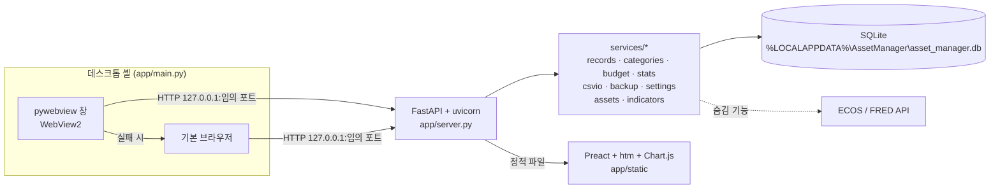
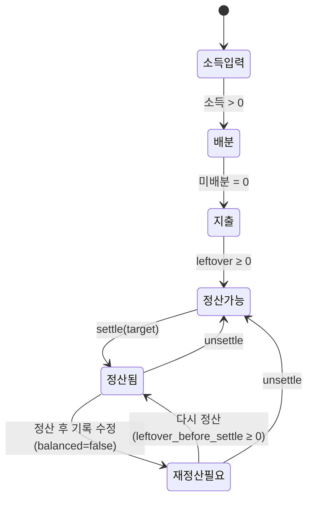
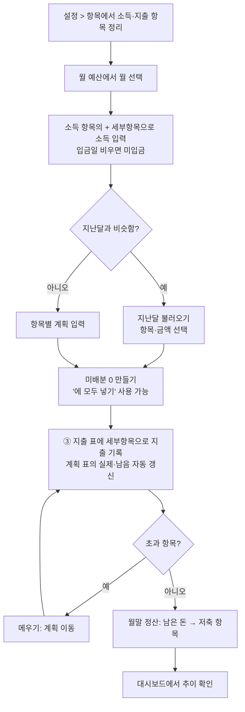

# 개인 자산 관리 프로그램 — 기능 명세서 (역설계)

- 대상 버전: v0.1.0 (`app/main.py` 창 제목 기준)
- 작성 방식: 2026-10-20 시점 소스 코드(`app/`, `tests/`, `asset_manager.spec`, `*.bat`)를 읽어 역으로 정리했습니다.
- 개정: 2026-10-20 설계 문제 정리(스키마 v6) 반영. 바뀐 내용은 맨 아래 "변경 이력"과 H절의 **[해결]** 표시를 참고하세요.
- 표기 규칙
  - **[사실]** 코드나 테스트에서 직접 확인한 내용입니다.
  - **[추정]** 코드 구조나 주석으로 미루어 본 의도이며, 직접 확인한 것은 아닙니다.
  - **확인 필요**: 이번 분석에서 검증하지 못한 부분입니다.
  - 구현 상태는 `구현 완료` / `부분 구현` / `미구현` / `백엔드만 구현(UI 숨김)` / `확인 필요` 중 하나로 표시합니다.

---

## A. 시스템 개요

### A-1. 목적
개인이 한 달 단위로 **소득 → 계획(배분) → 지출 → 월말 정산** 흐름을 관리하는 Windows 데스크톱 프로그램입니다. "들어온 돈을 모두 어딘가에 배분하고(미배분 0), 실제 쓴 돈과 맞춘다"는 봉투(envelope) 예산 방식을 씁니다. [사실: `services/budget.py`의 `unallocated`, `leftover`, `balanced` 계산]

자산 관리와 지표 추적 기능은 백엔드에 구현되어 있지만 현재 메뉴에서는 숨겨져 있습니다. [사실: `static/js/app.js`의 주석 "추후 다시 추가"]

### A-2. 사용자
- 단일 사용자가 로컬 PC에서 쓰는 프로그램입니다. 로그인이나 권한 개념은 없습니다. [사실: 인증 코드 없음]
- UI는 한국어, 금액은 원(KRW) 정수만 지원합니다. [사실: `util.parse_amount`가 소수 거부]

### A-3. 구성

| 구성 요소 | 기술 | 근거 |
|---|---|---|
| 런처 | `app/main.py` → 빈 포트 선택 → uvicorn 스레드 → pywebview 창 | [사실] |
| API 서버 | FastAPI, `/api/*` | [사실] `app/server.py` |
| 저장소 | sqlite3 (WAL, foreign_keys=ON), `PRAGMA user_version`으로 스키마 버전 관리 | [사실] `app/db.py` |
| 프런트엔드 | Preact + htm (vendor), Chart.js 4.4.6 (vendor), 해시 라우팅 | [사실] `static/vendor`, `lib.js` |
| 배포 | PyInstaller (`asset_manager.spec`, `launcher.py`) → `dist\AssetManager\AssetManager.exe` | [사실] |
| 외부 의존 | `fastapi>=0.115`, `uvicorn>=0.30`, `pywebview>=5.0` | [사실] `requirements.txt` |

### A-4. 화면(메뉴) 구성 — 현재 노출되는 것

| 메뉴 | 해시 | 파일 |
|---|---|---|
| 대시보드 | `#/dashboard` | `pages/dashboard.js` |
| 월 예산 (수입·지출) | `#/cashflow` | `pages/cashflow.js` |
| 설정 및 데이터 | `#/settings` | `pages/settings.js` (탭: 항목 / 백업·복원 / CSV) |

숨김 페이지: `pages/assets.js`, `pages/indicators.js`. 파일은 남아 있지만 라우팅되지 않습니다. [사실]

[사실] `app.js`의 `PAGES` 배열 키가 `dashboard`, `cashflow`, `settings`이며, 일치하는 키가 없으면 대시보드를 엽니다.

---

## B. 기능 목록

| ID | 기능 | 영역 | 구현 상태 |
|---|---|---|---|
| F-001 | 앱 실행·창 표시·종료 | 런처 | 구현 완료 |
| F-002 | 데이터 폴더·DB 초기화 및 스키마 마이그레이션(v0→v5) | 저장소 | 구현 완료 |
| F-003 | 항목(소득/지출) 추가 | 설정 > 항목 | 구현 완료 |
| F-004 | 항목 이름·색·메모 편집 | 설정 > 항목 | 구현 완료 |
| F-005 | 항목 순서 변경(드래그) | 설정 > 항목 | 구현 완료 |
| F-006 | 항목 삭제(개별 ✕ / 선택 삭제) | 설정 > 항목 | 구현 완료 |
| F-007 | 기록 옮기기(전체=합치기, 일부=나누기, 새 항목으로) | 설정·월 예산 | 구현 완료 |
| F-008 | 월 선택 및 월 예산 화면 구성 | 월 예산 | 구현 완료 |
| F-009 | 소득 세부항목 그리드 입력(이름·금액·입금일) | 월 예산 | 구현 완료 |
| F-010 | 소득 항목 접기/펼치기 | 월 예산 | 구현 완료 |
| F-011 | 소득 세부항목 선택 옮기기·선택 삭제 | 월 예산 | 구현 완료 |
| F-012 | 지출 계획 입력(항목별) | 월 예산 | 구현 완료 |
| F-013 | 지출 세부항목 입력(이름·금액·지출일), 실제 = 세부항목 합계 | 월 예산 | 구현 완료 |
| F-014 | 계획 이동(메우기)·미배분 모두 넣기 | 월 예산 | 구현 완료 |
| F-015 | 지난달 불러오기([항목]·[금액] 선택) | 월 예산 | 구현 완료 |
| F-016 | 월말 정산·다시 정산·정산 취소 | 월 예산 | 구현 완료 |
| F-017 | 진행 단계 표시(StepBar) | 월 예산 | 구현 완료 |
| F-018 | 이달 지출 기록 목록·검색·편집 | 월 예산 | 제거(F-013 지출 표로 대체) |
| F-019 | 대시보드 월 요약 카드 | 대시보드 | 구현 완료 |
| F-020 | 대시보드 차트(추이·저축·구성비·계획 대비·연간) | 대시보드 | 구현 완료 |
| F-021 | 미입금 소득 알림(선택한 달 기준) | 대시보드·월 예산 | 구현 완료 |
| F-022 | 백업 생성·목록·다운로드·삭제 | 설정 > 백업 | 구현 완료 |
| F-023 | 복원(목록에서 / 파일 업로드) | 설정 > 백업 | 구현 완료 |
| F-024 | 자동 백업(마이그레이션 전·복원 전·삭제 전) | 공통 | 구현 완료 |
| F-025 | 기록 CSV 가져오기(미리보기 → 적용) | 설정 > CSV | 구현 완료 |
| F-026 | CSV 내보내기(기록·항목) 및 양식 다운로드 | 설정 > CSV | 구현 완료 |
| F-027 | 데이터·백업·내보내기 폴더 열기 | 설정 > 백업 | 구현 완료 |
| F-028 | 화면 간 즉시 갱신(datachange) | 공통 | 구현 완료 |
| F-029 | 로컬 보안(Host 제한·CSRF 헤더·캐시 정책) | 서버 | 구현 완료 |
| F-030 | 통계 기준 전환(budget / cash) | API | 백엔드만 구현(UI 없음, H-14) |
| F-031 | 자산 관리(계좌·자산 유형·종목·거래·시세·평가) | 자산 | 백엔드만 구현(UI 숨김) |
| F-032 | 지표 추적(수동 값·ECOS·FRED 자동 업데이트) | 지표 | 백엔드만 구현(UI 숨김) |
| F-033 | API 키 설정(ECOS·FRED) | 설정 | 백엔드만 구현(UI 숨김) |
| F-034 | 자산 거래·시세·지표 CSV 가져오기/내보내기 | CSV | 백엔드만 구현(UI 숨김) |
| F-035 | 항목 비활성화/재활성화 | 항목 | 제외(v6에서 개념 제거, 항목은 삭제만 함) |
| F-036 | 계획 입력 방식 재설계 | 월 예산 | 미구현 (사용자 메모에 남은 할 일) [추정] |
| F-037 | 데이터 초기화(기록만 지우기 / 처음 상태로) | 설정 > 백업·복원 | 구현 완료 |

---

## C. 기능별 상세 명세

### F-001 앱 실행·창 표시·종료
- **입력**: 실행 옵션 `--browser`(브라우저로 열기), `--no-open`(창 없이 서버만), `--port N`(포트 지정). [사실: `main.py`]
- **처리**
  1. 127.0.0.1에서 빈 포트를 고르고, uvicorn을 별도 스레드에서 시작합니다.
  2. `/api/meta`가 응답할 때까지 최대 15초 기다립니다.
  3. pywebview 창을 엽니다(제목 "개인 자산 관리 v0.1.0", 1440×920, 최소 1024×680, 다운로드 허용). 실패하면 기본 브라우저로 엽니다.
  4. stdout이 없으면(pythonw나 exe 실행) 로그를 `app.log`로 보냅니다.
- **종료**: 창을 닫으면 `should_exit`를 설정하고 서버 스레드를 최대 5초 join합니다.
- **예외**: 치명적 오류는 Windows MessageBox로 표시합니다.
- **관련**: `app/main.py`, `launcher.py`, `asset_manager.spec`, `run.bat`, `build.bat`

### F-002 데이터 폴더·DB 초기화·마이그레이션
- **데이터 위치**: `%LOCALAPPDATA%\AssetManager`. 환경변수 `ASSET_MANAGER_DATA_DIR`로 바꿀 수 있습니다. 하위에 `asset_manager.db`, `backups\`, `exports\`, `app.log`가 있습니다. [사실: `config.py`]
- **마이그레이션** (`db.MIGRATIONS`, 순서대로 적용) [사실]

| 버전 | 내용 |
|---|---|
| v1 | 기본 테이블 생성, 초기 항목·자산 유형 시드 |
| v2 | `records.budget_month`, `records.tag` 추가, "저축·투자" 지출 항목 추가, 기존 소득의 budget_month 채움 |
| v3 | `categories.kind`(income/expense) 추가·분류, 고유 인덱스 (kind, IFNULL(parent_id,0), name) |
| v4 | `records.item` 추가, 하위 카테고리를 부모 항목의 세부항목 이름으로 바꾸고 하위 카테고리 삭제 |
| v5 | `categories.memo` 추가 |
| v6 | 비활성 항목을 모두 활성으로 되돌림, 쓰지 않는 설정 `income_basis`/`expense_basis` 삭제 (시드에서도 제거) |

- **규칙**
  - 기존 DB를 올리기 전에 `pre_migration_v{N}_*.db` 백업을 만듭니다.
  - DB 버전이 프로그램보다 높으면 실행을 거부합니다. [사실: `test_newer_schema_rejected`]
  - 마이그레이션은 여러 번 실행해도 결과가 같습니다. [사실: `test_migrate_is_idempotent`]

### F-003 ~ F-006 항목 관리 (설정 > 항목 탭)

**개념** [사실]
- **항목**(categories)은 설정에서 고정하며 모든 달에 공통으로 적용됩니다.
- **세부항목**(records.item)은 달마다 자유롭게 입력하는 텍스트입니다.
- 항목의 종류는 `income`(소득)과 `expense`(지출)입니다. 계획 기록과 실제 지출 기록은 모두 지출 항목에 연결됩니다.

| 기능 | 입력 | 처리·규칙 | 출력 |
|---|---|---|---|
| F-003 추가 | 이름 | 이름 ≤ 50자, 같은 kind 안에서 이름 중복 금지, sort_order = 같은 kind의 최댓값 + 1. 색은 팔레트에서 아직 안 쓴 색을 자동 배정(`nextColor`) | 목록에 즉시 표시, 월 예산 표에도 나타남 |
| F-004 편집 | 색(스와치), 이름, 메모 | 색은 `#RRGGBB` 형식, 메모 ≤ 200자. 칸을 벗어나면 저장. 다른 kind의 기록이 있으면 kind 변경 금지 | 이름을 바꿔도 연결된 기록은 유지됨 [사실: 테스트] |
| F-005 순서 | ⠿ 손잡이 드래그 | `POST /api/categories/{id}/reorder {before_id}`, 같은 kind 안에서만 | 월 예산 표 순서에 반영 |
| F-006 개별 삭제 | 행의 ✕ | 삭제 직전에 최신 기록 수를 다시 조회. 기록이 있으면 "연결된 기록(계획·지출 포함) N건도 함께 삭제됩니다…"를 확인한 뒤 `with_records=true`로 삭제. 백업은 아래 "삭제 백업 규칙"을 따름 | 항목과 기록 삭제 |
| F-006 선택 삭제 | 체크박스 + "선택 삭제" | `bulk-delete`는 항상 기록까지 삭제. 백업은 "삭제 백업 규칙"을 따름 | 위와 같음 |

- **삭제 백업 규칙(모든 삭제 공통)**: 지워지는 기록 중 금액이 0이 아닌 것이 하나라도 있으면 삭제 직전에 `pre_delete` 백업을 만들고, `pre_delete` 백업은 최근 30개만 남깁니다. 항목 개별·선택 삭제, 기록 개별·선택 삭제에 모두 똑같이 적용됩니다. [사실: `server.safety_backup`, `backup.prune_backups`, `test_delete_backup_rule_is_uniform`]
- **비활성화**: 없습니다. v6부터 항목은 늘 활성이며 `is_active`는 호환을 위해 남겨 둔 컬럼입니다.
- **예외 메시지 예시**
  - 이름 중복이면 400 오류
  - 기록이 있는데 `with_records`가 false면 400 오류 [사실: `test_category_delete_needs_confirmation_when_used`]
- **목록 표시**: 기록 수는 목록에 표시하지 않고 삭제 확인 창에서만 보여 줍니다. [사실: `settings.js`]

### F-007 기록 옮기기
- **목적**: 합치기, 나누기, 분류 변경을 "기록의 항목 바꾸기" 하나로 처리합니다. 기록 자체는 지우지 않으므로 월별 합계는 바뀌지 않습니다. [사실: `records.move_records` docstring]
- **진입점**
  - 설정의 항목 행에서 마우스를 올리면 나오는 "옮기기": 그 항목의 **모든 달** 기록을 목록으로 보여 주고 고르게 합니다.
  - 월 예산 소득 표에서 세부항목을 체크한 뒤 "선택 옮기기": 고른 기록을 바로 옮깁니다.
- **입력**: `ids`, 그리고 `category_id`(기존 항목) 또는 `new_category`({name, color})
- **규칙** [사실]
  - 소득 기록과 지출 계열(계획·지출) 기록을 섞어서 옮길 수 없습니다.
  - 옮길 곳은 같은 kind의 항목이어야 합니다.
  - 새 항목을 만들 때는 F-003과 같은 검증(`categories._validate`)을 거칩니다.
  - 새 항목 생성과 이동은 하나의 트랜잭션으로 처리되며, 실패하면 전부 롤백됩니다.
- **출력**: `{moved, category_id}`. 설정에서 전체를 옮겼으면 "빈 항목을 삭제할지" 묻습니다.
- **목록 열**: 월, 구분(소득/계획/실제/월말 정산), 세부항목(없으면 메모), 금액
- **관련 테스트**: `test_move_records_all_some_and_to_new_item`

### F-008 월 예산 화면
- **입력**: 월(MonthPicker). 해시 파라미터 `month`에 저장되며, 없으면 이번 달을 씁니다. [사실: `cashflow.js:14`]
- **API**: `GET /api/budget?month=YYYY-MM`
- **출력 구성**
  - 상단 StepBar(F-017)
  - 좌측(위에서 아래로): ① 소득 표(F-009), ② 계획 표(F-012), ③ 지출 표(F-013)
  - 우측: AllocationCard(F-014), SettleCard(F-016), 사용법 안내
- **pace(경과율)**: 이번 달이면 오늘까지 지난 일수의 비율, 지난달이면 1, 미래 달이면 0입니다.

### F-009 소득 세부항목 입력
- **표 구조**
  - 항목 행: 색, 이름(메모를 툴팁으로 표시), 합계, 마우스를 올리면 나오는 "+ 세부항목"
  - 세부항목 행: 체크박스, 이름, 금액, 입금일, ✕
- **"+ 세부항목"**: 금액 0, 이름이 빈 기록을 바로 만들고 이름 칸에 포커스를 줍니다.
- **기록 규칙** [사실: `validate_record`]
  - `budget_month`(예산 월)는 지정값을 쓰고, 없으면 입금일의 월, 그것도 없으면 month를 씁니다. 셋 다 없으면 오류입니다.
  - `month`는 입금일의 월이고, 미입금이면 budget_month를 씁니다.
  - 금액은 음수와 0을 허용하고, 빈 값은 0으로 처리합니다. 세부항목 이름 ≤ 60자, 메모 ≤ 500자입니다.
- **미입금**: 입금일이 없는 소득은 "미입금" 태그로 표시하고, 표 아래에 "미입금 … 포함"으로 안내합니다.
- **입력 방식(GridMoney)**
  - 포커스를 받으면 전체 선택, 칸을 벗어나면 저장합니다.
  - Enter는 같은 열의 아래 칸으로 이동, Esc는 원래 값으로 되돌립니다.
- **합계 표시**: "이번 달 쓸 돈" = 해당 budget_month 소득 합계

### F-010 소득 항목 접기/펼치기
- ▾/▸로 접고 펼칩니다. 상태는 `localStorage['am.collapsed.income']`에 저장되며, PC·브라우저 프로필마다 따로 남습니다. [사실]

### F-011 소득 세부항목 선택 작업
- 체크하면 SelectionBar가 나타나며 "선택 옮기기"(F-007), "선택 삭제"(`POST /api/records/bulk-delete`), "선택 해제"를 제공합니다.
- 기록 삭제(✕, 선택 삭제)에도 F-006의 "삭제 백업 규칙"이 적용됩니다. 빈 0원 행만 지울 때는 백업하지 않습니다.

### F-012 지출 계획 입력
- **입력**: 지출 항목별 계획 금액 (`PUT /api/budget/plan {month, category_id, amount}`)
- **규칙** [사실: `budget.set_plan`]
  - 지출 항목만 허용하고, 금액은 0 이상이어야 합니다.
  - 태그가 없는 계획 행을 모두 지우고 `amount − (태그 붙은 계획 합)`인 한 행으로 바꿉니다. 이동(move)과 정산(settle)으로 생긴 조정분은 그대로 남습니다. [사실: `test_set_plan_keeps_adjustments`]
- **표 열**: 항목 | 계획(입력) | 실제(③ 지출 합계, 읽기 전용) | 남음 = 계획 − 실제 | 진행 막대 | 메우기
- **표시**
  - 조정분이 있으면 계획 칸에 `*`를 붙입니다. 정산 지출이 포함된 실제 칸에는 "정"을 붙입니다.
  - 진행 막대: 채움 = 실제 ÷ 계획, 세로선 = 오늘(이번 달일 때만, 이달 경과율 pace 위치)
  - 막대 아래 글자
    - 왼쪽: `N% 사용`(계획 없으면 "계획 없음"), 상태가 `fast`면 "· 빠름"
    - 오른쪽: 초과면 `X원 초과`, 이번 달이고 남은 돈이 있으면 `하루 Y원` (= 남음 ÷ 오늘 포함 남은 날 수, 원 단위 내림)
    - 마우스를 올리면 사용률, 오늘의 이달 경과율, 남은 날 수를 툴팁으로 보여 줍니다.
  - 상태: `unplanned`/`empty`(계획 ≤ 0), `over`(초과), `done`, `fast`(지출률 > pace + 0.1), `ok`
- **미배분** = 소득 합계 − 계획 합계

### F-013 지출 세부항목 입력
- **표 구조**: 소득 표(F-009)와 같습니다.
  - 항목 행: 색, 이름(메모 툴팁), 세부항목 수, 합계, 마우스를 올리면 나오는 "+ 세부항목"
  - 세부항목 행: 체크박스, 이름, 금액, **지출일**, ✕
- **"+ 세부항목"**: 그 달(`month`)에 금액 0, 이름이 빈 지출 기록을 만들고 이름 칸에 포커스를 줍니다. Enter는 같은 줄의 다음 칸, 금액 칸의 Enter는 같은 열의 아래 칸으로 이동합니다.
- **지출일**: 기록의 `txn_date`입니다. 지출일을 바꿔도 기록은 처음 만든 달(`month`)의 예산에 남습니다. [사실: `validate_record`가 기존 month를 유지]
- **실제 지출** = 그 항목의 지출 기록 합계(정산 지출 포함)이며, ② 계획 표의 실제 칸에 자동으로 표시됩니다.
- **월말 정산 행**: "월말 정산 [정산]"으로 표시되며, 금액·지출일·삭제를 화면에서 고칠 수 없습니다.
- **선택 작업**: 체크하면 "선택 옮기기"(F-007, 지출 항목끼리), "선택 삭제", "선택 해제"가 나타납니다.
- **접기**: `localStorage['am.collapsed.expense']`에 기억합니다.
- **이전 방식 데이터**: 실제 칸에 합계를 직접 적던 때의 기록은 이름 없는 세부항목 한 줄로 보이며, 예전 메모가 있으면 이름 칸의 안내 글자로 보입니다.
- **API**: `POST /api/records`, `PUT /api/records/{id}`, `POST /api/records/bulk-delete`, `DELETE /api/records/{id}`. 이전의 합계 직접 입력 API(`PUT /api/budget/actual`)는 삭제했습니다.
- **화면에서 빠진 것**: 지출의 결제일(`settle_date`)과 메모는 입력 화면이 없습니다(데이터와 CSV에는 남음).

### F-014 계획 이동
- **"메우기"**: 남은 금액이 0보다 작은 항목에 다른 항목(또는 미배분)의 계획을 옮겨 옵니다. `POST /api/budget/move {month, from|null, to, amount}`를 호출하며, `tag='move'`인 계획 행 한 쌍을 기록합니다.
- **"에 모두 넣기"**: 미배분 금액 전체를 선택한 항목의 계획에 더합니다.
- **규칙**
  - 출발 항목에서 옮길 때: 출발 항목의 계획보다 많이 옮길 수 없습니다.
  - 미배분(from=null)에서 옮길 때: 서버도 미배분 금액보다 많이 옮기지 못하게 검사합니다. [사실: `test_move_plan_rules`]
- **관련 테스트**: `test_move_plan_rules`

### F-015 지난달 불러오기
- **진입**: 월 예산 머리의 월 선택 옆 "지난달 불러오기" 버튼. 언제든 누를 수 있습니다.
- **창 구성**: 체크박스 두 개. 각 줄 오른쪽에 불러올 개수와 금액 요약을 보여 줍니다(`GET /api/budget/copy-month?from&to`).
  - **[항목]**: 지난달 소득 세부항목을 이번 달에 같은 이름으로 만듭니다. 입금일은 비워 미입금으로 둡니다.
  - **[금액]**: 금액도 불러옵니다. 소득 세부항목은 지난달 금액으로, 지출 계획은 항목별 지난달 계획 금액으로 맞춥니다.
- **조합별 결과** (`POST /api/budget/copy-month {from, to, items, amounts}`) [사실: `budget.copy_month`, `test_copy_month_items_and_amounts`]

| 항목 | 금액 | 결과 |
|---|---|---|
| ✓ | ✓ | 소득 세부항목을 금액과 함께 만들고, 지출 계획을 지난달 금액으로 맞춤 |
| ✓ | – | 이름 있는 소득 세부항목만 0원으로 만들고, 지출 계획은 그대로 둠 |
| – | ✓ | 지출 계획만 지난달 금액으로 맞춤 |
| – | – | 불러오기 버튼이 꺼짐(서버도 거부) |

- **규칙**
  - 지출 계획 금액은 옮기기를 반영하고 정산 조정은 뺀 값입니다. 0원보다 큰 활성 지출 항목만 불러옵니다.
  - 이번 달에 같은 항목·같은 이름의 소득 세부항목이 이미 있으면 건너뛰므로, 두 번 눌러도 중복되지 않습니다.
  - 이번 달에 이미 계획이 있는 항목은 지난달 금액으로 바뀝니다. 그런 항목이 있으면 창에 경고를 띄우고 확인을 받습니다. 이번 달의 옮기기·정산 조정은 남기고 최종값이 지난달 금액이 되도록 맞춥니다(F-012 규칙).
  - 전체가 한 트랜잭션입니다.
- **이전 API**: `POST /api/budget/copy-plan`은 삭제했습니다.

### F-016 월말 정산 / 다시 정산 / 정산 취소
- **목적**: 남은 돈(leftover = 소득 − 지출)을 저축 같은 대상 항목으로 보내서 **소득 = 계획 = 지출**을 맞춥니다.
- **입력**: 대상 지출 항목. 기본값은 이름에 `저축|투자`가 들어간 항목입니다. 다시 정산할 때 생략하면 지난 정산의 대상(`settle_target`)을 씁니다. 처음 정산하면서 생략하면 오류입니다.
- **사전 조건** [사실: `budget.settle`, `test_settle_rejects_overspending`, `test_resettle_after_edit`]
  - 소득 ≤ 0이면 오류
  - leftover < 0이면 오류
- **처리**
  1. 각 항목의 계획이 실제 지출과 같아지도록 `tag='settle'` 계획 차액 행을 넣습니다. 대상 항목에는 leftover도 더합니다.
  2. 대상 항목에 leftover만큼 `tag='settle'` 지출 행을 넣습니다(월말 날짜, 세부항목 '월말 정산').
  3. 바뀐 것이 없으면 0원 표식 행을 넣습니다.
- 원래의 계획 행은 그대로 남습니다.
- **다시 정산**: 이미 정산된 달이면 기존 settle 행을 지우고 위 처리를 다시 합니다. 지우기와 다시 넣기는 한 트랜잭션이라, 조건이 맞지 않아 실패하면 기존 정산이 그대로 남습니다. UI는 정산 후 기록이 바뀌어 `balanced`가 false일 때 "다시 정산" 버튼을 보여 주고, `leftover_before_settle` < 0이면 버튼을 끕니다.
- **정산 취소**: `DELETE /api/budget/settle`로 그 달의 settle 행을 모두 지웁니다.
- **경고**: 미입금 소득이 있으면 SettleCard에 경고를 표시합니다.

### F-017 진행 단계 표시
- 단계: ① 소득 → ② 배분 → ③ 지출 % → ④ 정산
- `settled`와 `balanced` 값으로 "정산됨"과 "다시 필요"를 나눕니다. [사실: `cashflow.js`]

### F-018 이달 지출 기록 목록 (제거됨)
- 2026-10-20에 제거했습니다. 지출을 ③ 지출 표(F-013)에서 세부항목으로 바로 보고 고칠 수 있게 되어 목록·검색·수정 창(RecordModal)이 필요 없어졌습니다.

### F-019 / F-020 대시보드
- **카드**: 이달 소득, 지출, 저축과 저축률, 계획 대비 차이. 전월 대비 값도 함께 받습니다(`/api/stats/summary`).
- **차트**

| 차트 | 내용 | 비고 |
|---|---|---|
| 추이 | 6개월 / 12개월 / 올해의 월별 소득·지출·계획 | 월을 클릭하면 월 예산으로 이동 |
| 저축 | 저축액 막대 + 저축률 선 | 선이 위에 그려지도록 `order: 1` |
| 지출 구성비 | 상위 9개 + 기타 도넛 | |
| 계획 대비 실제 | 가로 막대 | 상태: no_actual, unplanned, over, ok |
| 연간 요약 | `/api/stats/annual` (상위 10개 포함) | |

- **집계 기준**: 기본은 `basis=budget`입니다. 소득은 예산 월, 계획과 지출은 month로 집계합니다.

### F-021 미입금 소득 알림
- `stats.pending_income(conn, month)`는 그 달 예산으로 잡힌(`COALESCE(budget_month, month)`) 소득 중 입금일이 없는 것의 건수와 합계를 셉니다. 대시보드 요약(`month_summary`)은 선택한 달을 넘깁니다. month를 생략하면 전체 달을 셉니다. [사실: `test_pending_income_by_month`]
- 월 예산 화면의 미입금 표시는 그 달 기준입니다(`income_items.pending`).

### F-022 ~ F-024 백업·복원
| 기능 | API | 규칙 |
|---|---|---|
| 생성 | `POST /api/backups` | 파일명 `{label}_{stamp}.db`, SQLite backup API 사용 |
| 목록 | `GET /api/backups` | `pre_`로 시작하면 "자동" 태그 |
| 다운로드·삭제 | `/api/backups/{name}` | `backup_path`가 경로 이탈을 막고 `.db` 확장자만 허용 |
| 복원(목록) | `POST /api/backups/{name}/restore` | `pre_restore` 백업 → 검증 → 복사 → 마이그레이션 |
| 복원(업로드) | `POST /api/restore-upload` (raw body) | 위와 같음 |

- **검증** [사실: `validate_backup_file`, `test_restore_rejects_invalid_files`]
  - SQLite 헤더와 `integrity_check`를 확인합니다.
  - 버전은 1 이상, 현재 버전 이하여야 합니다.
  - 필수 테이블은 버전이 현재와 같을 때만 확인합니다.
- **복원 후**: UI가 페이지를 다시 불러옵니다.
- **자동 백업 시점**
  - 마이그레이션 전: `pre_migration_v{N}`
  - 복원 전: `pre_restore`
  - 삭제 시: `pre_delete` (F-006 "삭제 백업 규칙", 최근 30개 유지)
  - 초기화 전: `pre_reset` (F-037)
- **API 경로**: 위 표의 경로 문자열은 기능 기준으로 정리했습니다. 정확한 HTTP 메서드와 경로는 `server.py`와 대조해야 합니다(**확인 필요**).

### F-025 / F-026 CSV
- **가져오기** (기록만 UI에 노출) [사실: `csvio.py`, 관련 테스트 4건]
  - 인코딩은 UTF-8(BOM 허용) 또는 CP949입니다. 파일은 최대 20 MB, 50,000행까지 받습니다.
  - 열: 구분, 항목(별칭 카테고리), 세부항목, 금액, 월(별칭 귀속월), 거래일, 결제일, 예산월, 메모
  - 구분 별칭: 수입, 지출계획, 실제지출 등
  - "A > B" 형식은 항목 A, 세부항목 B로 해석합니다.
  - **dry_run**: 앞 20행 미리보기와 오류 목록을 보여 줍니다. 오류는 200건까지 모읍니다.
  - **적용**: 전부 성공하거나 전부 실패합니다(원자적).
  - `create_missing`을 켜면 없는 항목을 만듭니다. 이때 색은 지정하지 않습니다.
- **내보내기**
  - 대상: 기록(전체 / 소득 / 계획 / 지출), 항목 목록
  - 인코딩은 UTF-8 BOM이며, 0원 행은 빼고 내보냅니다.
  - pywebview에서는 exports 폴더에 저장한 뒤 폴더를 엽니다. 브라우저에서는 파일을 내려받습니다.
- **양식**: records, asset_txns, prices, indicator_values

### F-037 데이터 초기화
- **위치**: 설정 > 백업·복원 탭 오른쪽 아래 "초기화" 패널
- **버튼**
  - **기록만 지우기** (`mode=records`): 모든 달의 소득·계획·지출 기록을 지웁니다. 항목, 설정, 숨긴 자산·지표 데이터는 그대로 둡니다.
  - **처음 상태로** (`mode=all`): 새로 설치한 상태로 되돌립니다. 기본 항목만 남고, 항목·기록·설정(API 키)·숨긴 자산·지표 데이터가 모두 지워집니다. 구현 방식은 임시 폴더에 새 DB를 만든 뒤 SQLite backup API로 현재 DB에 덮어쓰고 마이그레이션을 실행하는 것입니다.
- **안전장치**: 확인 창을 두 번 띄우고, 지우기 전에 반드시 `pre_reset_*.db` 백업을 만듭니다. 되돌리려면 백업 목록에서 그 파일을 복원합니다. 초기화가 끝나면 화면을 다시 불러옵니다.
- **API**: `POST /api/reset {mode: "records" | "all"}`. 다른 값을 보내면 400 오류입니다. [사실: `backup.reset`, `test_reset_records_and_all`]

### F-027 폴더 열기
- `POST /api/open-folder {target: data|backups|exports}`가 `os.startfile`로 탐색기를 엽니다. Windows 전용입니다.

### F-028 즉시 갱신
- `lib.api()`는 GET이 아닌 요청이 성공하면 `datachange` 이벤트를 보냅니다(30 ms 디바운스).
- `useApi`, App의 `reloadCategories`, 월 예산의 `load()`가 이 이벤트를 받아 다시 조회합니다. [사실]

### F-029 로컬 보안
- **TrustedHost**: 127.0.0.1, localhost, testserver만 허용합니다.
- **CSRF**: GET이 아닌 `/api/` 요청에는 `X-Requested-With: asset-manager` 헤더가 있어야 합니다. 없으면 거부합니다. [사실: `test_api_requires_csrf_header`]
- **캐시**: API가 아닌 응답에는 `Cache-Control: no-cache`를 붙이고, `.js`/`.css`의 MIME 타입을 명시합니다.

### F-030 통계 기준 전환
- `basis=cash`이면 소득은 입금일의 월로 집계하고 미입금은 빼며, 지출은 결제일 > 발생일 > month 순으로 정한 월에 집계합니다. [사실: `month_expr`, `test_expense_settle_date_basis`]
- 대시보드 코드에 `basis` 참조가 없으므로, UI는 늘 기본값 `budget`을 씁니다. [사실: `dashboard.js` grep 결과] 설정의 `income_basis`/`expense_basis` 행은 쓰이지 않습니다. (H-03)

### F-031 자산 관리 (백엔드만)
- **거래 종류**: deposit, withdrawal, transfer, buy, sell, dividend, interest, fee, valuation, adjustment
- **검증**
  - 수수료는 buy, sell, transfer에만 붙일 수 있습니다.
  - 부호 있는 금액은 valuation과 adjustment만 허용합니다.
  - 생성·수정·삭제할 때마다 원장을 다시 검사해 보유량보다 많이 팔면 거부하고 롤백합니다. [사실: `test_oversell_rejected_and_rolled_back`]
- **평가**
  - 이동평균 단가를 씁니다.
  - 수익 항등식: 실현 + 미실현 + 배당 + 이자 − 수수료 + 평가 = 총손익 [사실: `test_buy_sell_realized_unrealized_identity`]
  - 시세는 등록된 시세를 우선 쓰고, 없으면 마지막 거래가를 씁니다.
  - 월별 수익률은 Modified Dietz 방식에 가깝게 계산합니다. [추정: 코드 주석과 계산식으로 판단]
- 이체(transfer)는 소득으로 잡지 않습니다. 소수 수량을 허용합니다. 계좌를 삭제하면 비활성화됩니다. [사실: 테스트]
- **UI**: `pages/assets.js`가 있지만 라우팅되지 않습니다. 화면이 지금 데이터 구조와 맞게 동작하는지는 **확인 필요**입니다.

### F-032 지표 추적 (백엔드만)
- **프리셋**: kr_base_rate, usdkrw, kr_cpi, kospi, kr_treasury_3y, sp500, us_10y, fed_funds, us_cpi
- **수동 값**: 날짜별로 저장(같은 날짜면 덮어씀)하며 숫자만 받고 NaN과 Inf는 거부합니다.
- **refresh**
  - 마지막 값 날짜의 40일 전부터 다시 받아 옵니다. `full`이면 처음부터 받습니다.
  - 실패하면 `last_error`를 기록하고 기존 값은 유지합니다. [사실: `test_indicator_refresh_without_key_keeps_data`]
- **refresh_all**: 수동 지표와 비활성 지표는 건너뜁니다.

### F-033 API 키 설정 (백엔드만)
- `settings.ALLOWED`에는 `ecos_api_key`와 `fred_api_key`만 있습니다. 조회할 때는 값을 가리지만, DB에는 평문으로 저장됩니다. [사실]

---

## D. 데이터 및 상태 정의

### D-1. 테이블 (주요 컬럼)
컬럼 목록은 마이그레이션 코드를 읽고 정리했습니다. `created_at`/`updated_at` 같은 메타 컬럼은 일부만 확인했습니다(**확인 필요**).

| 테이블 | 주요 컬럼 | 비고 |
|---|---|---|
| `categories` | id, name, kind(income/expense), parent_id(레거시), color, memo, sort_order, is_active | 고유 (kind, IFNULL(parent_id,0), name) |
| `records` | id, kind(income/plan/expense), category_id → categories, amount(정수), month, txn_date, settle_date, budget_month, item, memo, tag, updated_at | |
| `settings` | key, value | API 키, 미사용 기준 값 |
| `asset_types`, `accounts`, `securities`, `asset_txns`, `security_prices` | — | 숨김 기능 |
| `indicators`, `indicator_values` | indicator_values (indicator_id, date) 고유 | 숨김 기능 |

### D-2. records.tag 의미 [사실]
| tag | 의미 | 만드는 곳 |
|---|---|---|
| NULL | 사용자가 입력한 기록 | 그리드 입력, CSV |
| `move` | 계획 이동 | F-014 |
| `settle` | 월말 정산 조정 | F-016 |

### D-3. 월 예산 계산식 [사실: `budget.get_budget`]
- 소득(income) = Σ income.amount, 단 budget_month = 해당 월
- 계획(plan) = Σ plan.amount (모든 tag 포함)
- 지출(spent) = Σ expense.amount
- 미배분(unallocated) = 소득 − 계획
- 남은 돈(leftover) = 소득 − 지출
- 초과 합계(over_total) = Σ max(0, 지출 − 계획) (항목별)
- settled = 그 달에 settle 행이 하나라도 있음
- balanced = (미배분 = 0) ∧ (leftover = 0) ∧ (소득 > 0)
- settle_target = 그 달 정산의 대상 항목 (정산 전이면 null)
- leftover_before_settle = leftover + 정산 지출(settle 태그 expense) 합 → 다시 정산할 수 있는지 판단

### D-4. 값 검증 (`util.py`) [사실]
- **금액**: 쉼표와 "원"을 제거하고, 소수는 거부하며, |n| ≤ 1e15입니다.
- **월**: `YYYY-MM`이며 구분자로 `.`과 `/`도 받습니다. 연도는 1900~2999입니다.
- **날짜**: 실제로 있는 날짜만 받습니다.
- **기간**: 최대 1200개월입니다.

### D-5. 클라이언트 상태
- `localStorage['am.collapsed.income']`: 소득 항목 접힘 상태
- 해시 파라미터: 페이지와 월
- App Context: categories, settings, meta

---

## E. 사용자 흐름

### E-1. 첫 설정 → 한 달 예산

### E-2. 항목 정리 (합치기·나누기)

### E-3. 백업·복원
수동 백업 → 문제 발생 → 목록에서 복원 또는 파일 업로드 → `pre_restore`가 자동으로 만들어짐 → 페이지 다시 불러오기

---

## F. 외부 인터페이스

### F-1. 내부 HTTP API (127.0.0.1 전용)
| 그룹 | 엔드포인트 (요약) |
|---|---|
| 메타·설정 | `GET /api/meta`, `GET·PUT /api/settings`, `POST /api/open-folder` |
| 항목 | `GET /api/categories?kind&active_only`, `POST /api/categories`, `PUT·DELETE /api/categories/{id}`(`with_records`), `POST /api/categories/{id}/reorder`, `POST /api/categories/bulk-delete` |
| 기록 | `GET·POST /api/records`, `PUT·DELETE /api/records/{id}`, `POST /api/records/move`, `POST /api/records/bulk-delete` |
| 예산 | `GET /api/budget`, `PUT /api/budget/plan`, `POST /api/budget/move`, `POST·DELETE /api/budget/settle`, `GET·POST /api/budget/copy-month` |
| 통계 | summary, trend, plan-vs-actual, breakdown, annual (`/api/stats/*`) |
| 백업 | 목록, 생성, 다운로드, 삭제, 복원, `restore-upload` |
| CSV | export(records, asset-txns, prices, categories, indicator/{id}; `save=true`), templates, import |
| 숨김 | assets / accounts / securities / prices / asset-txns / indicators / ECOS 항목 조회 |

- **공통 오류 처리**
  - AppError, IntegrityError(FK·UNIQUE를 한국어 메시지로 변환) → 400
  - OperationalError → 500
- **공통 헤더**: GET이 아닌 요청에는 `X-Requested-With: asset-manager`가 필요합니다.
- 응답 JSON의 세부 스키마는 서비스 함수의 반환 dict와 같습니다. 전체 필드 목록은 문서화하지 않았습니다(**확인 필요**).

### F-2. 외부 API (숨김 기능)
- **ECOS**(한국은행): StatisticSearch, StatisticItemList. 키는 `ecos_api_key`입니다.
- **FRED**: series observations. 키는 `fred_api_key`입니다.
- 요청 URL과 파싱 세부 사항은 `providers/ecos.py`, `fred.py`에 있습니다. 이번 분석에서는 함수 이름과 테스트(`test_ecos_parsing`, `test_fred_parsing`)만 확인했습니다(**확인 필요**).

### F-3. 파일 인터페이스
- **CSV**: D-4와 F-025/F-026 규칙을 따릅니다.
- **백업 파일**: SQLite `.db`
- **로그**: `app.log`

### F-4. OS 연동
- pywebview(WebView2), `os.startfile`, Windows MessageBox

---

## G. 비기능 요구사항 (코드에 근거가 있는 것만)

| ID | 항목 | 근거 |
|---|---|---|
| N-01 | 오프라인 동작: 숨김 지표 갱신을 빼면 네트워크가 필요 없음. 라이브러리는 vendor로 포함 | `static/vendor`, 외부 CDN 참조 없음 |
| N-02 | 로컬 전용 접근: 127.0.0.1에 바인딩, TrustedHost 제한 | `main.py`, `server.py` |
| N-03 | CSRF 방어: 사용자 정의 헤더 검사 | `server.py`, 테스트 |
| N-04 | 데이터 무결성: FK ON, WAL, 원자적 CSV 가져오기와 기록 옮기기, 원장 검사 롤백 | `db.py`, `csvio.py`, `records.py`, `assets.py` |
| N-05 | 데이터 보호: 마이그레이션·복원·삭제 전 자동 백업, 경로 이탈 차단 | `db.py`, `backup.py`, `server.py` |
| N-06 | 입력 한도: 금액 ≤ 1e15, 텍스트 길이 제한, CSV 20 MB / 50,000행, 기간 ≤ 1200개월 | `util.py`, `csvio.py` |
| N-07 | 하위 호환: 예전 스키마는 자동으로 올리고, 더 새로운 스키마는 거부 | `db.migrate` |
| N-08 | 기동 시간: 서버 준비를 최대 15초 기다림 | `main.py` |
| N-09 | 최소 창 크기 1024×680. 월 예산 화면은 1200px 이하에서 배분·정산 카드를 표 위에 두 칸으로 놓고 표를 한 칸으로 쌓습니다. 표가 패널보다 넓으면 패널 안에서 가로 스크롤합니다(밖으로 넘치지 않음) | `main.py`, `app.css` |
| N-10 | 테스트: pytest 61건, 2026-10-20 기준 모두 통과 | `tests/` |
| N-11 | 한국어 메시지와 CP949 CSV 지원 | 전체, `csvio.py` |

성능 목표(응답 시간 등)나 접근성 요구사항은 코드에서 근거를 찾지 못했습니다.

---

## H. 미해결 사항 · 불일치 · 설계 문제

| ID | 내용 | 근거 | 영향 |
|---|---|---|---|
| H-01 | 대시보드 카드와 차트를 클릭하면 `tab`, `category` 파라미터를 붙여 월 예산으로 이동하지만, 월 예산 화면은 이 값을 쓰지 않음. 빈 화면 안내 문구가 이미 없어진 "월별 수입·지출 → 지출 계획 탭"을 가리킴 | `dashboard.js`, `cashflow.js` | **[해결] 대시보드 클릭은 월만 넘기고, 안내 문구는 "월 예산 화면의 지출 표에서 항목별 계획을 입력하세요"로 고침.** (원래 영향: 클릭한 항목으로 바로 가지 못함, 안내가 틀림) |
| H-02 | `pending_income()`이 달을 가리지 않고 모든 달의 미입금 소득을 셈 | `stats.py` | **[해결] 선택한 달 기준으로 셈(F-021).** (원래 영향: 대시보드에서 선택한 달과 맞지 않는 숫자가 보임) |
| H-03 | `settings`의 `income_basis`/`expense_basis` 행은 시드되지만 아무 데서도 쓰지 않음. `ALLOWED`에도 없음 | `db.py`, `settings.py` | **[해결] v6 마이그레이션으로 지우고 시드에서도 뺌.** (원래 영향: 죽은 데이터) |
| H-04 | `is_active`는 남아 있지만 비활성화나 재활성화 UI가 없음. 비활성 레거시 항목은 데이터가 있는 달에만 나타나고, 비활성 항목에 새 기록을 넣으면 "설정에서 다시 활성화하세요"라는 오류가 남 | `records.py:26`, `budget.py` | **[해결] 비활성화 개념을 없앰. v6에서 모든 항목을 활성으로 되돌리고 비활성 검사와 "(비활성)" 표시를 지움.** (원래 영향: 오류 메시지가 안내하는 기능이 없음) |
| H-05 | 자산·지표 백엔드와 API 키 엔드포인트가 UI에서는 숨겨졌는데 계속 동작함. API 키는 평문으로 저장됨 | `server.py`, `settings.py` | 공격 표면과 유지보수 부담. 보안 영향은 로컬 한정이라 낮음 |
| H-06 | 삭제 백업 정책이 다름: 항목 선택 삭제는 항상 백업, 개별 삭제는 기록이 있을 때만 백업, 기록 선택 삭제는 백업 없음 | `server.py` | **[해결] 모든 삭제에 같은 규칙 적용: 0원이 아닌 기록이 지워질 때 백업, 최근 30개 유지.** (원래 영향: 복구 가능 범위가 일정하지 않음) |
| H-07 | 지출 세부항목에 지출일(txn_date)은 입력할 수 있지만 결제일(settle_date)은 화면에서 입력할 수 없음. 지출일을 비운 기록은 `cash` 기준 집계에서 month로만 잡힘 | `records.py` | 두 기준의 의미가 흐려짐 |
| H-08 | 서버의 `move_plan(from=None)`은 미배분 잔액을 검사하지 않고, UI만 검사함 | `budget.py` | **[해결] 서버도 미배분 한도를 검사함.** (원래 영향: API를 직접 부르면 미배분이 음수가 될 수 있음) |
| H-09 | 정산한 뒤 기록을 고쳐도 `settled`가 계속 true임. UI는 "다시 필요"로 표시하지만, 재정산하려면 먼저 취소해야 함 | `budget.py`, `cashflow.js` | **[해결] "다시 정산"으로 한 번에 다시 정산함(F-016).** (원래 영향: 사용자가 한 단계를 더 거쳐야 함) |
| H-10 | 지난달 불러오기(`copy_month`)의 계획 금액에 move 태그 계획까지 포함됨 | `budget._plan_to_copy` | 지난달에 한 번만 조정한 금액이 이번 달 기본 계획으로 굳어짐 [추정: 의도가 맞는지 확인 필요] |
| H-11 | 항목 삭제 확인 창의 "기록 수"(`record_count`)에 계획, move, settle 행이 모두 들어감 | `categories.list_categories` | 사용자가 생각하는 건수보다 크게 보일 수 있음 |
| H-12 | 레거시 흔적: `CategorySelect`가 `parent_id`가 있으면 "└"를 그림, `list_records`가 부모 카테고리를 조인하고 `include_children`을 씀, CSV 열 별칭에 "카테고리"와 "귀속월"이 남음 | `lib.js`, `records.py:186-224`, `csvio.py` | **[일부 해결] `CategorySelect`의 "└", `list_records`의 `include_children`을 지움. 부모 조인과 CSV 별칭(옛 파일 호환)은 남김.** (원래 영향: v4 이후로는 쓰이지 않는 코드) |
| H-13 | CSV 양식 목록에 자산과 지표 양식이 남아 있고, 백업 화면 안내에 "자산·지표"가 언급됨 | `csvio.py`, `settings.js` | **[일부 해결] 백업 안내 문구에서 자산·지표를 뺌. 화면은 기록 양식만 보여 주며, 서버의 자산·지표 양식은 숨긴 기능용으로 남김.** (원래 영향: 숨긴 기능이 화면에 드러남) |
| H-14 | `basis=cash` 통계를 지원하지만 UI에서 고를 방법이 없음 | `stats.py`, `dashboard.js` | 기능과 테스트만 있고 화면에서 쓰이지 않음 |
| H-15 | 확인 창이 네이티브 `window.confirm`이라 제목이 "127.0.0.1:포트의 메시지"로 나옴 | `lib.confirmBox` | 사용성 저하 |
| H-16 | 창을 닫은 뒤 프로세스가 끝나기까지 몇 초 걸림(서버 join 최대 5초) | `main.py`, 관찰 결과 | 바로 다시 실행하거나 빌드하면 파일이 잠겨 있을 수 있음 |
| H-17 | 계획 입력 방식을 다시 손볼 예정이라는 사용자 메모가 남아 있음 | 사용자 메모 | 요구사항이 아직 정해지지 않음 |
| H-18 | `create_missing`으로 만든 항목에 색이 없음. UI에서 추가한 항목은 팔레트 색을 자동으로 받음 | `csvio.py`, `lib.nextColor` | 표시가 일관되지 않음 |
| H-19 | 금액 0인 기록을 허용하고 "+ 세부항목"이 0원 행을 바로 만듦. 이름도 금액도 없는 빈 행이 DB에 남을 수 있음 | `validate_record`, `cashflow.js` | 데이터에 잡음이 생김. 내보내기에서는 0원 행이 빠짐 |

---

## 부록: 검증 체크리스트 결과
1. **기능 ID 대응**: 노출된 메뉴 세 개와 각 탭의 모든 버튼·입력을 F-003~F-029에 대응시켰습니다.
2. **구현 상태 구분**: 숨김 기능은 "백엔드만 구현(UI 숨김)", 데이터만 있고 기능이 없는 것은 "미구현"으로 표시했습니다.
3. **사실/추정 구분**: 테스트나 코드로 확인한 규칙에는 [사실], 의도를 미루어 본 곳에는 [추정]을 붙였습니다.
4. **확인 필요 표시**: 검증하지 못한 경로, 스키마, UI 존재 여부를 모두 "확인 필요"로 남겼습니다.
5. **코드 변경 없음(최초 작성 시)**: 최초 작성 때는 이 문서 하나만 만들었습니다. 이후 코드 변경은 "변경 이력"에 적었습니다.

---

## 변경 이력

| 날짜 | 스키마 | 내용 |
|---|---|---|
| 2026-10-20 | v5 | 최초 작성(역설계) |
| 2026-10-20 | v6 | 코드 정리(동작 변화 없음): 화면에서 안 쓰던 API `PUT /api/budget/actual`·`POST /api/budget/copy-plan`과 그 함수 삭제, 여러 문장 트랜잭션을 `db.transaction()` 하나로 통일(기록 옮기기·정산·지난달 불러오기·계획 입력), 계획 맞추기 로직을 `_set_plan_total` 하나로 합침, 정산 대상 조회 공통화. 화면은 소득·지출 표를 `ItemSheet` 하나로 합치고, 저장할 때마다 예산을 두 번 다시 불러오던 것을 한 번으로 줄임. 쓰지 않는 컴포넌트(`CategorySelect`)·상수·import·CSS 규칙 23개 삭제 |
| 2026-10-20 | v6 | 설정에 데이터 초기화 추가(F-037). 좁은 창에서 계획 표가 옆 카드 위로 넘치던 문제 수정: 1200px 이하에서 한 칸 배치, 패널 안 가로 스크롤, 진행 막대 글자 줄바꿈(N-09) |
| 2026-10-20 | v6 | 계획 표 진행 막대 아래에 사용률과 하루 쓸 수 있는 금액(또는 초과 금액) 글자 추가 |
| 2026-10-20 | v6 | 지출도 소득처럼 항목 + 세부항목(이름·금액·지출일)으로 기록하는 ③ 지출 표 추가. ② 계획 표의 실제는 세부항목 합계로 자동 계산. "이 달 지출 전체 내역"과 수정 창 제거(F-013, F-018) |
| 2026-10-20 | v6 | "지난달 계획 불러오기"를 "지난달 불러오기"로 바꿈: 월 선택 옆으로 옮기고 [항목]·[금액] 체크박스 창 추가(F-015). 정산 안내 문구의 "(보통 저축)" 삭제 |
| 2026-10-20 | v6 | 월 예산의 "이 달 지출 전체 내역"에서 CSV 버튼 제거, 안내를 "항목순"으로 수정 |
| 2026-10-20 | v6 | 설계 문제 정리. H-01, H-02, H-03, H-04, H-06, H-08, H-09는 해결, H-12와 H-13은 일부 해결. 테스트 6건 추가(총 60건) |
| 2026-10-21 | v6 | 언어(한국어/영어)·날짜 표기·금액 단위 표시 설정 1단계(F-038, F-039): 설정 > 표시 탭 추가, 앱 셸·서버 오류·CSV 열 이름·새 DB 기본 항목 이름이 언어를 따름, 전체 초기화 후 표시 설정 유지. 저장 값·스키마 불변. 나머지 화면 문구 번역은 2단계. 테스트 58건 추가(총 119건) |
| 2026-10-21 | v6 | 언어 2단계(F-038, F-039): 월 예산·대시보드·옮기기 창·설정 전 탭·공통 컴포넌트 문구와 브라우저 탭 제목이 언어를 따름. 화면 날짜(정산 행·백업 시각·차트 월·연도)가 날짜 표기 설정을 따름. 옮기기·정산 시스템 기록 메모는 저장 값(한국어) 그대로 두고 영어 설정일 때 화면·기록 목록·CSV 내보내기에서만 번역. 통계 집계 기준 이름·"설정됨"·CSRF 403 문구(code `http.forbidden`)·CSV 파일 이름도 언어를 따름. 기본 정산 대상 추정이 영어 저축·투자 항목도 잡음. 남은 한국어: 브라우저 기본 날짜·월 입력 위젯, 숨김 자산·지표. 스키마 불변. 테스트 77건 추가(총 196건) |
| 2026-10-21 | v6 | 영어 번역·언어 설정 제거(F-038 삭제): 앱은 한국어 한 가지. 날짜 표기(4가지)·금액 단위(3가지) 표시 설정은 유지하고 설정 > 표시 탭은 "표시 형식"으로 축소. 서버 문구는 `app/messages.py`, 영어 CSV 열 이름·양식·파일 이름 제거(옛 `language`·`auto` 값은 무시). 저장 값·스키마 불변. 테스트 221건 |

남은 주요 과제: H-05(숨긴 백엔드), H-07(지출 날짜와 cash 기준), H-10(지난달 계획 불러오기에 이동분 포함), H-11(삭제 확인 건수), H-14(cash 기준 UI 없음), H-15(네이티브 확인 창), H-16(종료 지연), H-17(계획 입력 재설계), H-18, H-19
